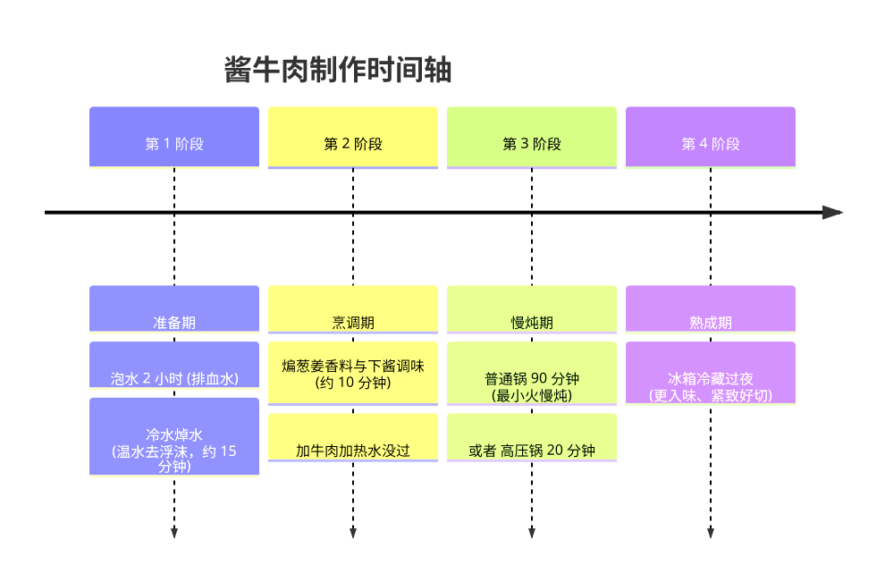

学的村驴：
<https://www.bilibili.com/video/BV1xE4m1d73b/>

小高姐的也看看：
<https://www.bilibili.com/video/BV1VW41147Fh/>

## 配料

等比例缩放 _村驴_ 的配料。

500g 牛肉的配比如下：

| 🥩 主料 & 葱姜 | 🧂 调味酱汁 | 🌰 干香料（💡 也可直接用 1 个卤料包 ） |
| :--- | :--- | :--- |
| • **牛腱子肉**：500g • **大葱**：23g • **生姜**：13g • **香菜根**：1 个 | • **酱油**：66g • **黄豆酱**：1 勺 • **白糖**：6g • **盐**：任意 | • **大料类**：八角 1个、香叶 2片、白芷 1片、草果 小半个 • **颗粒类**：小茴香 1捏、花椒粒 1捏 • **辣味**：干辣椒 任意 |

## 步骤

1. 牛腱子肉 500g 泡水两小时排血水
2. 冷水下锅焯水，用温水洗牛肉去浮沫。不要用冷水否则可能缩水变难吃
3. 油微热下姜片，中火煎一会。下入大葱和香菜根，大葱散开有焦边，转小火下香料翻炒
4. 放入黄豆酱一勺，酱油 66g，糖6g，盐任意
5. 下入牛肉。加开水没过牛肉，大火烧开转最小火
6. 炖 90 分钟（高压锅20分钟）
7. 放冰箱冷藏一夜更好吃，也更好切。

## 注意

牛肉一定要选牛腱肉。**スネ肉**。\
日本超市不是很容易买到，大点的 Life 超市是有的，肉店也有。\
もも肉感觉更常见一点，试过，做出来跟拖鞋一样难吃。

牛肉从焯水的步骤开始，就不可以碰冷水了。之后的步骤都是热水。

解冻肉也可以。解冻要放在冷藏缓慢解冻，不要微波炉。
